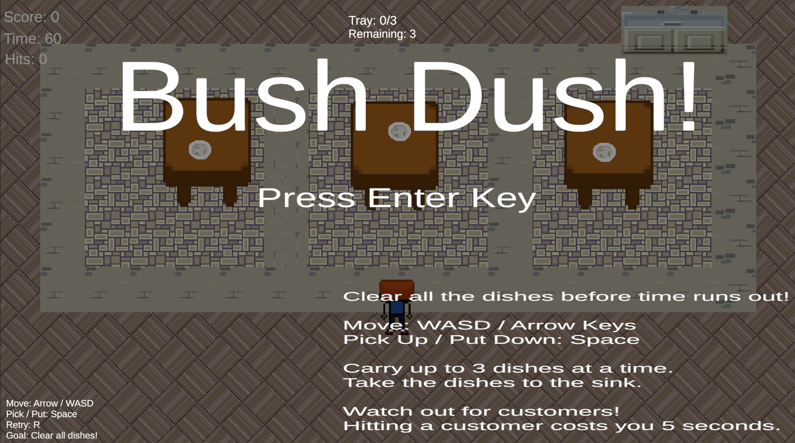
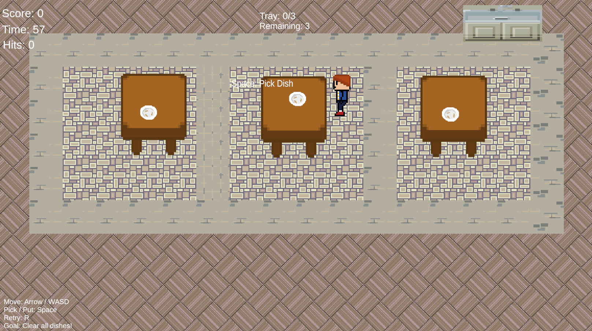
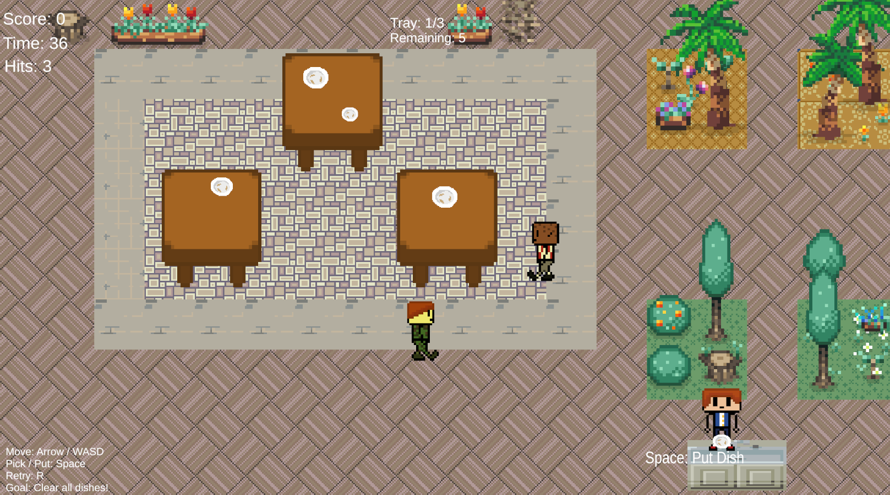
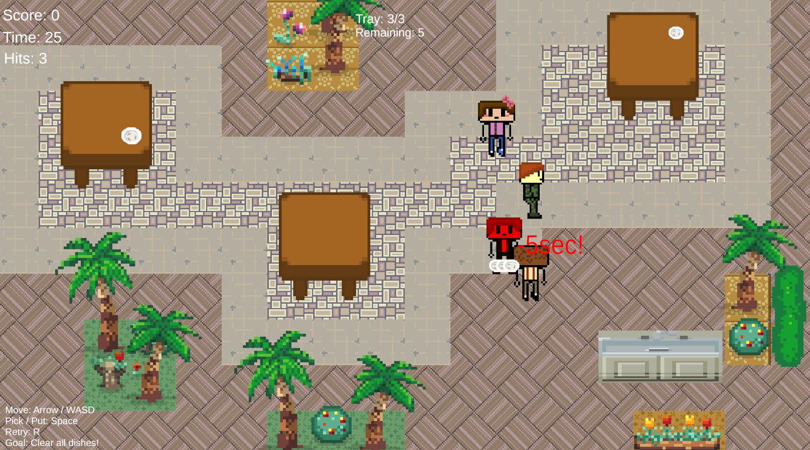

# BushDash

飲食店でのアルバイト経験をもとに制作した、2D皿回収アクションゲームです。

プレイヤーはホールスタッフとして、お客さんを避けながらテーブル上の皿を回収し、制限時間内にすべての皿を洗い場へ運びます。

## ゲーム概要

- ジャンル：2Dアクションゲーム
- プレイ人数：1人
- ステージ数：3
- 開発環境：Unity 6
- 使用言語：C#
- 制作形態：個人制作

## ゲームの目的

ステージ内にある皿を回収し、制限時間内にすべて洗い場へ運ぶとクリアです。

プレイヤーは一度に最大3枚まで皿を持つことができます。

ステージ内を移動するお客さんに衝突すると、時間が5秒減少します。

## 操作方法

| 操作 | キー |
|---|---|
| 移動 | WASD / 矢印キー |
| 皿を拾う・置く | Space |
| リトライ | R |
| ゲーム開始 | Enter |

## 実装した機能

- プレイヤーの上下左右移動
- 皿の取得・運搬・配置
- 最大所持数の制限
- 最も近い皿の取得判定
- お客さんの往復移動
- お客さんの歩行アニメーション
- お客さんとの衝突判定
- 衝突時の時間ペナルティ
- 衝突時のカメラシェイク
- プレイヤーとお客さんの一時停止演出
- スコア・タイマー・残り皿数・衝突回数の表示
- BGM・効果音
- クリア・ゲームオーバー
- リトライ・ステージ遷移
- タイトル画面
- 全3ステージ

## 工夫した点

### 1. 複数の皿が近い場合の取得判定

当初は `OnTriggerEnter2D` と `OnTriggerExit2D` を使って、取得可能な皿を管理していました。

しかし、複数の皿の取得範囲が重なると、表示が重複したり、プレイヤーに最も近い皿を正しく取得できなかったりする問題が発生しました。

そこで、`Physics2D.OverlapCircleAll` を使ってプレイヤー周辺の候補を取得し、距離を比較して最も近い皿を取得対象にする方式へ変更しました。

### 2. プレイヤーとお客さんの処理を分離

プレイヤーに関する処理は `PlayerContorolla`、お客さんの移動やアニメーション、一時停止処理は `CustomerMover`、カメラの揺れは `CameraShake` に分けました。

それぞれのスクリプトが担当する役割を分けることで、不具合が発生した際に確認する場所を分かりやすくしました。

### 3. 衝突を直感的に伝える演出

お客さんに衝突した際は、時間を減らすだけでなく、以下の演出を加えました。

- カメラを短時間揺らす
- プレイヤーを一瞬停止させる
- お客さんも一瞬停止させる
- 効果音を再生する
- 衝突回数を更新する

これにより、プレイヤーが衝突したことを視覚と音の両方から理解できるようにしました。

### 4. 手持ち皿の描画順

プレイヤーが上を向いている場合は皿を身体の後ろに表示し、下を向いている場合は身体の前に表示するようにしました。

プレイヤーの向きに応じて、手持ち皿の `SpriteRenderer.sortingOrder` を変更しています。

## 使用技術・ツール

- Unity 6
- C#
- Visual Studio
- Git / GitHub
- Piskel
- Tilemap
- TextMesh Pro
- Unity AudioSource
- Unity 2D Physics

## 開発で学んだこと

- UnityにおけるColliderとTriggerの使い分け
- 複数オブジェクトが近接した場合の判定方法
- クラスや関数ごとに処理の役割を分ける考え方
- コルーチンを用いた時間制御
- SpriteRendererによる描画順の制御
- Gitを用いた機能単位でのバージョン管理
- ログやInspectorを使った不具合の切り分け

## 今後の改善案

- 皿を多く持つほどリスクが高くなる仕組み
- お客さんとの衝突による皿の落下
- テーブルごとの優先度や制限時間
- テーブル清掃など、皿回収以外の作業
- ステージごとのゲーム性の差別化
- UI・演出・サウンドの追加調整

## スクリーンショット

## タイトル画面

## プレイ画面

## 素材について

本作品では、以下の画像・音声素材を使用しています。  
各素材は、配布元の利用規約および利用条件を確認した上で使用しています。

### 画像素材

- **2D 16-bit pixel top-down sprites**  
  制作者：Godn0ta

- **Free Pixel Tileset + Character Spritesheet**  
  制作者：VoodooMoose

- **Kitchen Assets**
  制作者：Reakain  
  使用素材：kitchen_v1.png  
  配布元：itch.io

  - **[LPC] Floors**
  編集・公開：bluecarrot16 and LPC contributors  
  配布元：[OpenGameArt.org](https://opengameart.org/content/lpc-floors)  
  ライセンス：CC BY-SA 4.0  
  使用素材：floors.png  
  詳細な制作者一覧は配布元ページおよび同梱の `CREDITS-floors.txt` を参照してください。
### BGM

- **Welcome to our cafe**  
  制作者：のる  
  配布元：DOVA-SYNDROME

- **南国の風**  
  制作者：shimtone  
  配布元：DOVA-SYNDROME

- **Café After the Rain**  
  制作者：lofichilldj  
  配布元：BOOTH

### 効果音

- **Onoma-Flash 系効果音**
- **Onoma-Negative 系効果音**  
  配布元：OtoLogic

- **お皿、食器に放り込む（ザラララララ）03**
- **ぶつかる・擬音02**  
  配布元：On-Jin ～音人～

- **カーソル移動9**  
- **パッ.mp3** 
  配布元：効果音ラボ

- **put_empty_plate**  
  制作者：小森平  
  配布元：無料効果音で遊ぼう！

  ### 自作素材

- **dirtyplate.png（汚れた皿の画像）**  
  自作

一部の素材については、配布元および利用条件を確認後、必要に応じて追記します。

## 開発状況

Version 1.0.0 完成